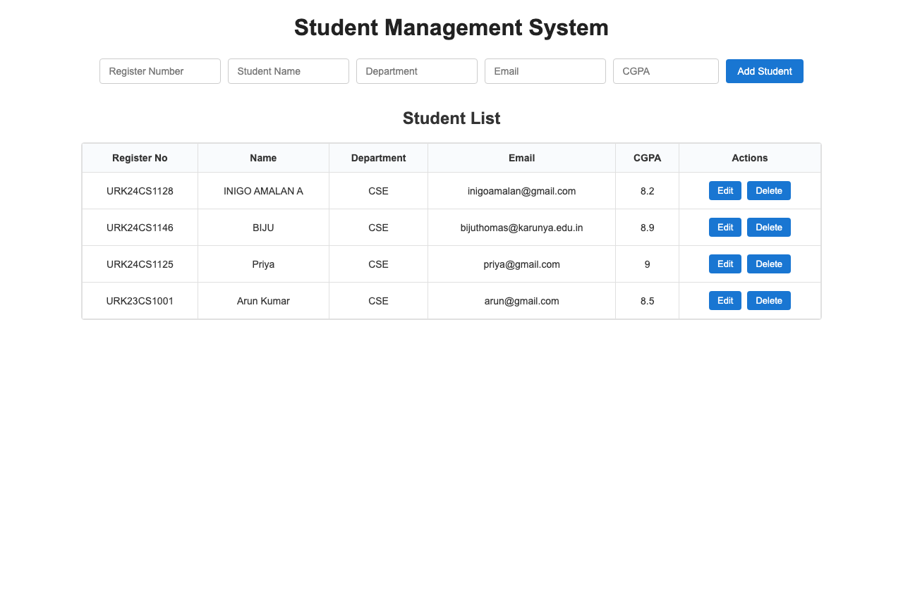

# Experiment 12: Full Stack Web Application Development using NodeJS, ReactJS and MongoDB

**Course**: 23CS2049 – Web Technology Lab  
**Register No**: URK24CS1128  

## Aim
To design and develop a full stack web application using ReactJS for the frontend, NodeJS with ExpressJS for the backend, and MongoDB for database storage, and to perform Create, Read, Update and Delete (CRUD) operations.

## Architecture
- **Frontend**: ReactJS (Vite) running on `http://localhost:5173`
- **Backend**: NodeJS + ExpressJS REST API running on `http://localhost:5000`
- **Database**: MongoDB (`studentdb`, collection `students`) running on `mongodb://127.0.0.1:27017`
- **Communication**: Axios for HTTP REST calls between React and Express

## CRUD Endpoints
- `POST /students` - Create a student record
- `GET /students` - Read all student records
- `GET /students/:id` - Read a single student record
- `PUT /students/:id` - Update a student record
- `DELETE /students/:id` - Delete a student record

## Output Preview


## How to Run

### 1. Start MongoDB
Ensure MongoDB service is running:
```bash
brew services start mongodb-community
```

### 2. Run Backend
```bash
cd FullStackStudentApp/backend
npm install
node server.js
```

### 3. Run Frontend
```bash
cd FullStackStudentApp/frontend
npm install
npm run dev
```
Open browser at `http://localhost:5173`.
